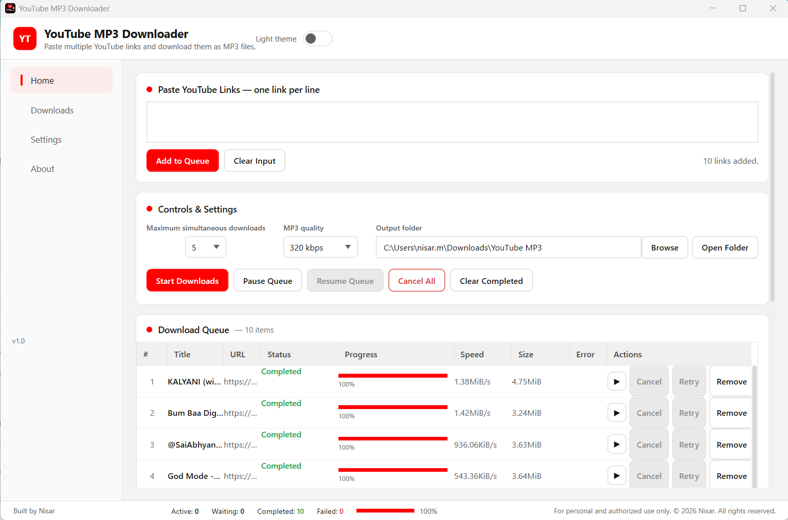
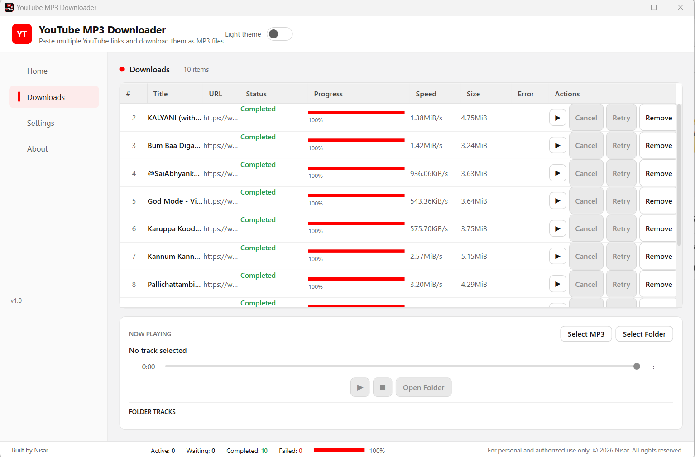
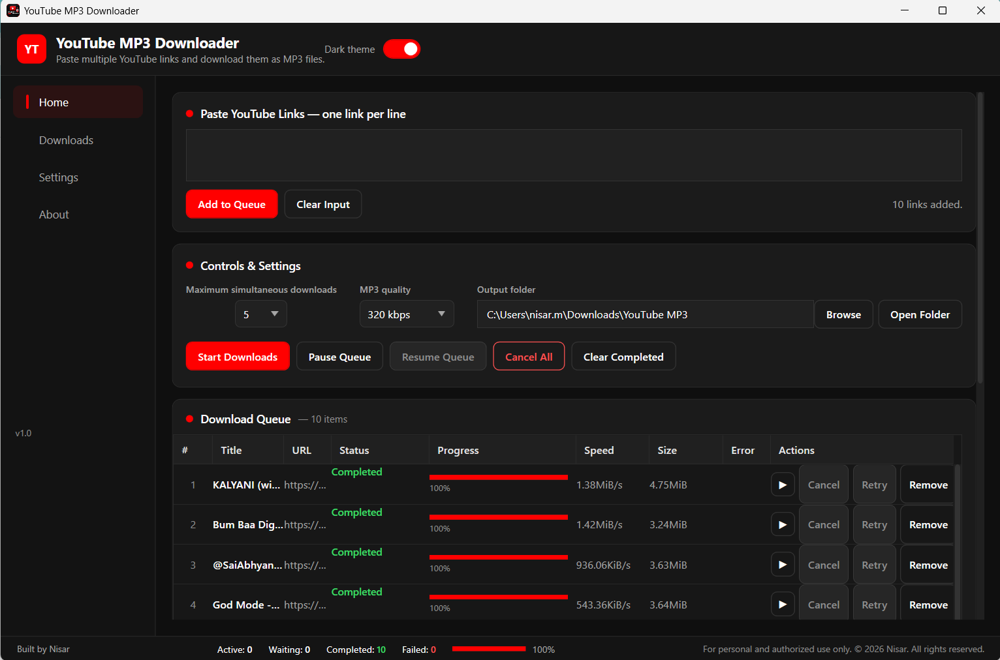

\# YouTube MP3 Downloader


A Windows desktop application for downloading YouTube audio as MP3, with multiple-link queue management, concurrent downloads, a built-in MP3 player, and optional Chrome integration.


\*\*Multiple links. One queue. Up to five concurrent downloads.\*\*


## Application Screenshots

### Home — Multiple-Link Batch Downloads

Paste multiple YouTube links, configure MP3 quality and concurrent downloads, and manage everything from one queue.



### Downloads — Queue and Built-in MP3 Player

Track completed downloads, manage individual items, and play downloaded MP3 files directly in the application.



### Dark Theme — Modern Dark Interface

Switch between light and dark themes while managing multiple downloads, MP3 quality, and your download queue.




\## Features


\- \*\*Multiple-link downloading:\*\* Paste several YouTube video URLs at once, one per line.

\- \*\*Concurrent downloads:\*\* Configure between 1 and 5 simultaneous downloads.

\- \*\*MP3 quality selection:\*\* Choose 128, 192, 256, or 320 kbps.

\- \*\*Download queue management:\*\* Start downloads, pause or resume queue scheduling, cancel downloads, and clear completed items.

\- \*\*Built-in MP3 player:\*\* Play downloaded MP3s or select existing files and folders.

\- \*\*Chrome companion extension:\*\* Send the currently open supported YouTube video directly to the desktop application.

\- \*\*Light and dark themes:\*\* Choose your preferred appearance.

\- \*\*Local Windows application:\*\* No separate cloud account is required.


\## Download and Install


Download `YouTube-MP3-Downloader-Setup-v1.0.0.exe` from the GitHub Releases page once the first release is published.


1\. Run the installer.

2\. Follow the installation wizard.

3\. Optionally select \*\*Create a desktop shortcut\*\*.

4\. Select \*\*Open Chrome Extension Setup Instructions\*\* if you want Chrome integration.

5\. Complete installation and launch YouTube MP3 Downloader.


The installer is currently unsigned. Windows may display a SmartScreen warning. Verify that the installer comes from the official repository before deciding whether to run it.


The Chrome extension is optional. All direct downloading features are available through the desktop application.


\## Download Multiple YouTube Links


1\. Open YouTube MP3 Downloader.

2\. Copy one or more supported YouTube video URLs.

3\. Paste them into the link input area, placing each URL on a separate line.

4\. Add the links to the download queue.

5\. Choose your preferred MP3 quality and output folder.

6\. Configure the number of concurrent downloads (1–5).

7\. Start downloading.


You can monitor individual items and manage the queue without adding each link separately.


\## Optional Chrome Companion Extension


The Chrome extension lets you send the currently open supported YouTube video to the desktop application.


After installing the desktop app:


1\. Open Chrome and navigate to `chrome://extensions`.

2\. Enable \*\*Developer mode\*\*.

3\. Click \*\*Load unpacked\*\*.

4\. Select the `ChromeExtension` folder inside the application installation directory.

5\. Confirm that \*\*Nisar MP3 Downloader Companion\*\* appears.


Keep the desktop application running when using the extension.


The extension provides two actions:


\- \*\*Add to Queue:\*\* Sends the current video to the queue without starting downloads.

\- \*\*Add \& Start:\*\* Sends the video and starts queue processing.


Expected extension ID: `degdafbfgoodjcnhbnialnbdfahlfoce`


\## System Requirements


\*\*For installed users:\*\*

\- Windows 10 (version 1809 or later) or Windows 11, 64-bit

\- Google Chrome only if using the optional companion extension


\*\*For developers:\*\*

\- .NET 10 SDK

\- Windows development environment with WPF support

\- yt-dlp and FFmpeg components

\- Inno Setup 6 for installer packaging


The installer is designed as a self-contained Windows build, so end users do not need to install the .NET SDK.


\## Build from Source


Clone the repository and open PowerShell in the project directory.


Build the desktop application:


```powershell

dotnet build .\\YouTube-MP3-Downloader.csproj -c Release

```


Build the Chrome native messaging host:


```powershell

dotnet build .\\NativeHost\\YouTubeMp3NativeHost.csproj -c Release

```


The application uses yt-dlp and FFmpeg for downloading and media processing. These tools must be supplied separately when building from source. Refer to their official distribution and licensing documentation.


Installer packaging additionally requires the appropriate self-contained publish output and Inno Setup.


\## Troubleshooting


\*\*The Chrome extension cannot connect:\*\* Make sure the desktop application is running and that the native messaging host is correctly registered.


\*\*The Chrome extension reports forbidden access:\*\* Verify that its ID matches the ID in the native host's `allowed\_origins`.


\*\*A video fails to download:\*\* Check your connection and whether the content is available. YouTube authentication or anti-bot checks can affect individual downloads.


\*\*The installer shows an unknown publisher warning:\*\* The current installer is not digitally code-signed. Verify the download source and file integrity before proceeding.


\## Responsible Use


Use this application only for content you own, have permission to download, or are otherwise legally authorized to download. Users are responsible for complying with applicable copyright laws and platform terms.


This is an independent project and is not affiliated with or endorsed by YouTube or Google.


\## Third-Party Components


This application uses yt-dlp and FFmpeg. Their respective licenses and notices must be respected when building or redistributing the application.


\## Author


\*\*Nisar\*\*


Version 1.0.0 — Initial public release.

